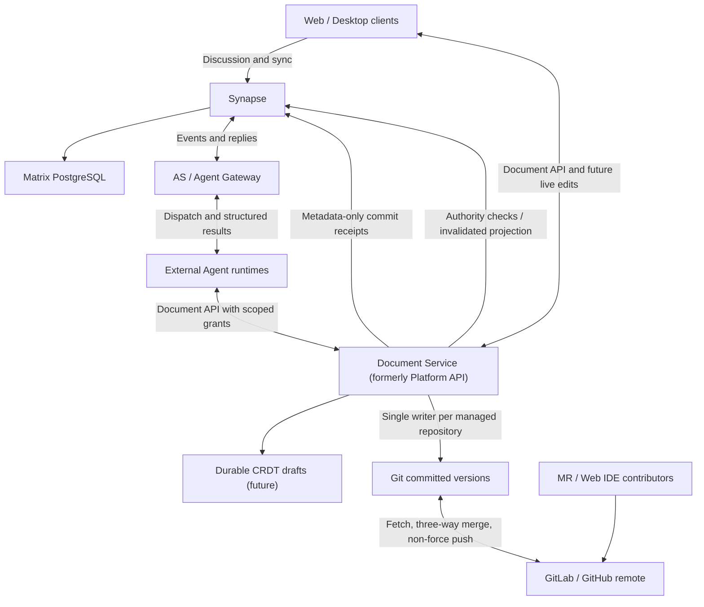

# Architecture (V0.2 design proposal)

## Status

[ADR 0001](adr/0001-matrix-git-agent.md) remains accepted for MVP design. The diagram and target ownership below describe [ADR 0002](adr/0002-document-service-boundaries.md), **Proposed**, from [#18](https://github.com/douyixuan/didadi/issues/18). They are not a deployment inventory or an implementation-completion claim.

At inspected main `f0ab205`, human saves still use Matrix → AS/Gateway → external worker → GitDocs. See [CLIENT.md](CLIENT.md), [GIT_DOCUMENTS.md](GIT_DOCUMENTS.md) and [VALIDATION.md](VALIDATION.md) for implemented behavior and limitations. Separate drafts #31–#40 include structured results, direct saves and scoped Document API work in #37–#39; they are not integrated here.

## Logical components (proposed target)

The Document Service owns both hot-state reconciliation and Git persistence; the CRDT is not an independent version authority. A logical service may initially be cohosted. Direct saves bypass AS/Gateway task dispatch and external workers, but still require valid Matrix-derived authorization. Receipt delivery failure is separate from durable-save success.

## Ownership

- **Matrix / Synapse:** identity, rooms/spaces, membership, power levels, discussion and metadata-only commit receipts. No automatic document-body transport or document RPC. User-authored quotations remain discussion.
- **Document Service (formerly Platform API):** document read/write/history API, authorization enforcement, scoped-grant validation, per-repository writer ownership, merge/conflict handling and recoverable receipt delivery. Clients and runtimes cannot bypass it to write managed Git repositories.
- **Git:** sole authority for committed Markdown versions and history. Normal remote divergence is integrated with a non-force three-way merge; conflicts preserve both sides and surface to users. No force-push or silent loss of unpublished work.
- **Future CRDT store:** durable uncommitted collaboration state, reconciled by the Document Service and committed on idle/publish. Draft durability, Git commit and remote publication are distinct acknowledgments; storage and CRDT libraries remain unselected.
- **AS / Agent Gateway and metadata:** managed agent identity, durable tasks, dispatch, audit and retry state. Repository/path bindings, grant records and invalidated membership projections are metadata, not a separate ACL authority or document-content store. The Document Service validates current authority and scope on use.
- **External runtime:** execution environment and model state; an API client with bounded, expiring, revocable grants. Task IDs provide idempotency, not permission. Results are structured and contain references rather than document bodies.
- **Existing spike only:** document notification intent currently lives in Git commit metadata and delivery receipts in local Git refs. [#16](https://github.com/douyixuan/didadi/issues/16) proposes attributed commits without Matrix routing IDs in pushed history; a recoverable metadata migration must precede claims that this privacy boundary is implemented.

## Protocol guardrails

- Application Service is an integration adapter, not server-side event interception.
- Preserve ADR 0001's exclusion of automatic E2EE agent access. Unencrypted workspace policy, federation product stance and TypeScript service selection are proposals requiring confirmation; see ADR 0002's decision table.
- Derive authorization from Matrix membership/power levels bound to a canonical repository path prefix; fail closed when authority cannot be trusted. Space inheritance and power thresholds need explicit policy.
- Resource grants are server-validated and bound to agent, repository, path prefix, actions and expiry. Messages cannot select their own authority. Revocation applies to active sessions as well as new requests.
- Deduplicate Matrix transactions/events and API operations. Durable task state and retries must survive restart; protocol control flow must never parse human reply prose ([#14](https://github.com/douyixuan/didadi/issues/14)).
- One active service writer per managed repository; keep local locks and Git ref CAS. Cross-host failover requires fencing, not distributed `flock`.
- Preserve Markdown source ([#13](https://github.com/douyixuan/didadi/issues/13)); add three-way merge before CRDT ([#15](https://github.com/douyixuan/didadi/issues/15)). Do not infer persistent block IDs from completed source-preservation work.

## Implementation sequence

Follow [ADR 0002's migration order](adr/0002-document-service-boundaries.md#migration-order): verify correctness/performance prerequisites, accept boundaries, deliver direct IO/receipts/structured results and commit privacy, then block identity/three-way merge, then durable CRDT collaboration. Reuse the separate draft implementation stack after its own review and integration; this document-only PR does not merge or alter it.
